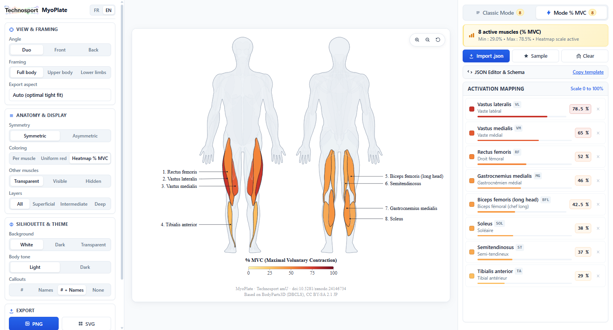
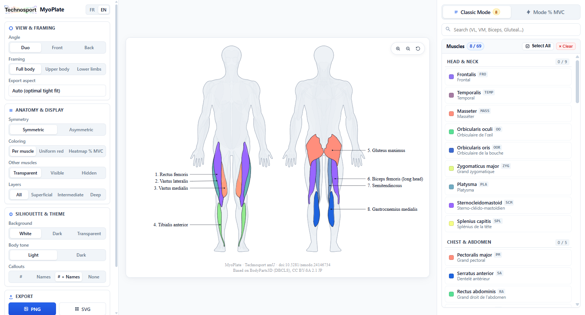

# MyoPlate

**Interactive sEMG Mapping & Figure Builder**

[](https://github.com/Technosport)
[](#)
[](https://technosport.github.io/MyoPlate/)
[](https://doi.org/10.5281/zenodo.24146734)
[](LICENSE)
[](NOTICE.md)

> **MyoPlate - Interactive sEMG Mapping & Figure Builder.**
>
> *A 2D vector tool for surface electromyography (sEMG) protocol illustration and muscle activation visualization (% MVC).*
>
> *Developed at **Technosport / ISM** (UMR 7287 CNRS - Aix-Marseille Université) • [**Launch Web Application**](https://technosport.github.io/MyoPlate/)*

<p align="center">
  
</p>

---

## 🚀 Getting Started

### Online Access (GitHub Pages)
- **Direct Web Access**: **[technosport.github.io/MyoPlate](https://technosport.github.io/MyoPlate/)**

### Offline / Local Usage
1. Clone or download this repository.
2. Double-click the standalone **`index.html`** file in any web browser.

---

## 🛠️ Features & Highlights

<p align="center">
  
</p>

| Module / Feature | Description |
| :--- | :--- |
| **Protocol Mode (Classic)** | Interactive selection of 69 anatomical muscles, customizable color families or monochrome, and flexible visual callouts (Numbers, Names, or Numbers + Names). |
| **Results Mode (% MVC Heatmap)** | Continuous dynamic thermal heatmap (0 to 100% MVC) with adjustable color scales and real-time live activation gauges. |
| **Views & Framings** | Anatomical angles (Dual Anterior + Posterior, Anterior only, Posterior only) and adaptive framings (Full body, Upper body, Lower limbs). |
| **Publication Aspect Ratios** | Auto-Fit (tight bounding box without wasted margins) or standardized publication ratios (16:9, 4:3, 9:16, 3:4, 1:1). |
| **Vector & High-Res Export** | Direct export to **vector SVG** (up to 2048 px) for Adobe Illustrator / PowerPoint / LaTeX and **high-definition PNG** (up to 4096 px) with embedded citation metadata. |
| **JSON Import / Export** | Batch import and export of muscle activation values with automatic recognition of standard sEMG abbreviations (VL, VM, RF, BF, MG, LG, TA, GM, etc.). |
| **Bilingual Interface (EN / FR)** | Switch the entire user interface and exported legends between English and French with a single click. |

### JSON Format for % MVC Activation Import

The application accepts full anatomical identifiers or standard sEMG acronyms interchangeably:

```json
{
  "measures": [
    { "muscle": "vastus-lateralis", "mvc": 78.5 },
    { "muscle": "VM", "mvc": 65.0 },
    { "muscle": "RF", "mvc": 52.0 },
    { "muscle": "gastrocnemius-medial", "mvc": 46.0 },
    { "muscle": "BF", "mvc": 42.5 },
    { "muscle": "SOL", "mvc": 38.0 },
    { "muscle": "ST", "mvc": 37.0 },
    { "muscle": "TA", "mvc": 29.0 }
  ]
}
```

> 💡 **Reference Dictionary**: A complete dataset and dictionary covering all 69 anatomical muscles (with standardized IDs, sEMG abbreviations, bilingual names, and sample values) is provided in **[`example_all_muscles.json`](example_all_muscles.json)** and can be imported directly into the application.

---

## 📜 How to Cite & Academic License

If you use MyoPlate figures or activation maps in a scientific publication, thesis, or report, please cite both this tool and the underlying anatomical database:

### Recommended Citation (APA)
> Panchairi, J. (2026). *MyoPlate - Interactive sEMG Mapping & Figure Builder* (Version 1.1.0) [Computer software]. Zenodo. https://doi.org/10.5281/zenodo.24146734

### BibTeX
```bibtex
@software{panchairi2026myoplate,
  author       = {Panchairi, Jean},
  title        = {{MyoPlate: Interactive sEMG Mapping & Figure Builder}},
  year         = {2026},
  publisher    = {Zenodo},
  version      = {v1.1.0},
  doi          = {10.5281/zenodo.24146734},
  url          = {https://technosport.github.io/MyoPlate/}
}
```

### In Figure Captions
> *Figure X. Muscle activation map generated using MyoPlate (Technosport amU, ISM UMR 7287 CNRS / Aix-Marseille Université; doi:10.5281/zenodo.24146734), based on BodyParts3D (DBCLS, CC BY-SA 2.1 JP).*

### Anatomical Database Citation
> Mitsuhashi, N., Fujieda, K., Tamura, T., Kawamoto, S., Takagi, T., & Okubo, K. (2009). *BodyParts3D: 3D structure database for anatomical concepts*. **Nucleic Acids Research**, 37(suppl_1), D782-D785. https://doi.org/10.1093/nar/gkn613

### License Summary
- **Source Code**: Released under the **[MIT License](LICENSE)**.
- **Anatomical Vector Data & Exported Figures**: Released under **[CC BY-SA 2.1 JP](https://creativecommons.org/licenses/by-sa/2.1/jp/)**, derived from [BodyParts3D](https://lifesciencedb.jp/bp3d/) (DBCLS). Full details and commercial / publication rules in **[NOTICE.md](NOTICE.md)**.
