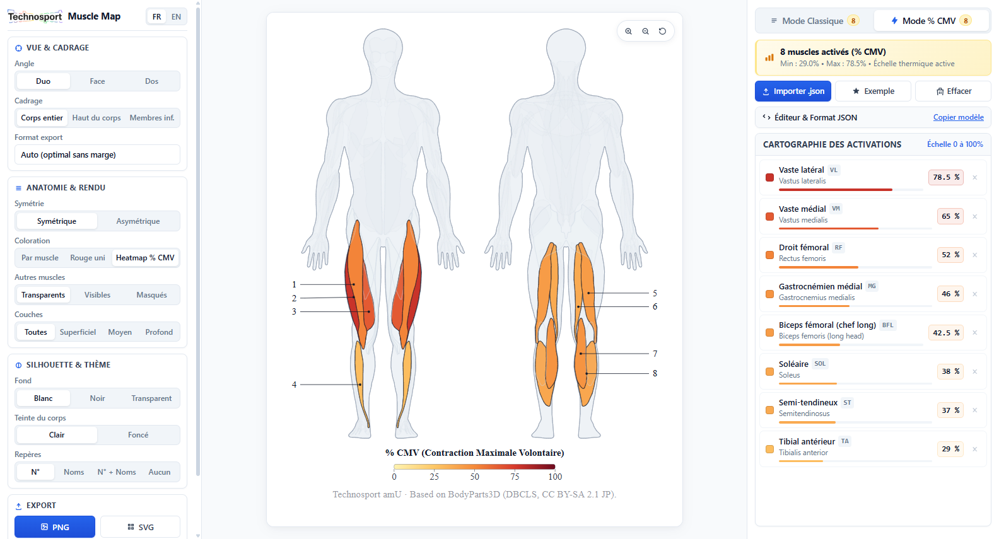
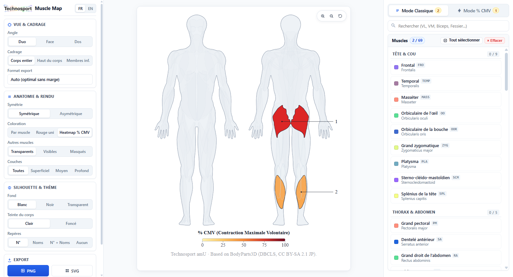

# Muscle Map

[](https://github.com/Technosport)
[](#)
[](https://technosport.github.io/Muscle-Map/)

> **Cartographie anatomique vectorielle 2D pour l'illustration de protocoles d'électromyographie de surface (sEMG) et la visualisation thermique des niveaux d'activation (% CMV).**  
> *Développé au sein du **Technosport / ISM** (UMR 7287 CNRS — Aix-Marseille Université) • [**Application en ligne**](https://technosport.github.io/Muscle-Map/)*

<p align="center">
  
</p>

---

## 🚀 Démarrage

### Accès en ligne (GitHub Pages)
- **Accès direct (Web)** : **[technosport.github.io/Muscle-Map](https://technosport.github.io/Muscle-Map/)**

### Utilisation locale
1. Télécharger ou cloner ce dépôt sur la machine.
2. Double-cliquer sur le fichier **`index.html`** dans un navigateur (Chrome, Edge, Firefox, Safari).

> [!NOTE]
> L'application est 100% autonome (~1.5 Mo) : elle fonctionne intégralement hors-ligne, sans dépendance externe, sans appel CDN et sans serveur web local requis.

---

## 🛠️ Fonctionnalités & Contenu

<p align="center">
  
</p>

| Module / Fonctionnalité | Description |
| :--- | :--- |
| **Mode Protocole (Classique)** | Sélection interactive parmi 63 muscles anatomiques, coloration par famille ou unicolore, et repères visuels (N°, Noms ou N° + Noms). |
| **Mode Résultats (Heatmap % CMV)** | Cartographie thermique dynamique continue (0 à 100 % CMV / % MVC) avec échelle chromatique paramétrable et jauges d'activation en direct. |
| **Vues & Cadrages** | Angles anatomiques (Duo Face + Dos, Face seule, Dos seul) et cadrages adaptatifs (Corps entier, Haut du corps, Membres inférieurs). |
| **Formats & Ratios** | Rendu automatique sans marges (Auto-Fit) ou ratios prédéfinis pour publications scientifiques et présentations (16:9, 4:3, 9:16, 3:4, 1:1). |
| **Export Vectoriel & 4K** | Export direct en **SVG vectoriel** (jusqu'à 2048 px) pour Illustrator / PowerPoint / LaTeX et en **PNG haute résolution** (jusqu'à 4096 px). |
| **Import / Export JSON** | Importation et exportation de jeux de données d'activation avec reconnaissance des abréviations sEMG standards (VL, VM, RF, BF, MG, LG, TA, GM, etc.). |
| **Bilingue FR / EN** | Interface complète et légendes exportées commutables instantanément en Français ou en Anglais. |

<details>
<summary><b>Voir les raccourcis clavier et contrôles interactifs</b></summary>

- `P` : Afficher ou masquer le volet de configuration (gauche).
- `M` : Afficher ou masquer le volet des muscles et activations (droite).
- `Molette souris` ou touches `+` / `-` : Zoom continu sur la planche anatomique.
- `Double-clic` ou bouton `↺` : Réinitialiser la vue et le centrage.

</details>

<details>
<summary><b>Voir le format JSON pour l'import d'activations (% CMV)</b></summary>

L'application accepte indifféremment les identifiants anatomiques complets ou les abréviations sEMG usuelles :

```json
{
  "mesures": [
    { "muscle": "vastus-lateralis", "cmv": 78.5 },
    { "muscle": "VM", "cmv": 65.0 },
    { "muscle": "RF", "cmv": 52.0 },
    { "muscle": "gastrocnemius-medial", "cmv": 46.0 },
    { "muscle": "BF", "cmv": 42.5 },
    { "muscle": "SOL", "cmv": 38.0 },
    { "muscle": "ST", "cmv": 37.0 },
    { "muscle": "TA", "cmv": 29.0 }
  ]
}
```

</details>

---

## 🔧 Architecture & Personnalisation

| Fichier / Dossier | Rôle dans le projet |
| :--- | :--- |
| **`index.html`** | Application finale autonome et monolithique distribuable (embarquant styles, logique et atlas vectoriel). |
| **`app.template.html`** | Gabarit source de l'interface (HTML5, styles CSS et scripts JavaScript). |
| **`muscle_map_data.json`** | Base de données vectorielle des 63 muscles et silhouettes (coordonnées 2D normalisées). |
| **`build_app.py`** | Script de compilation réinjectant les données vectorielles dans le gabarit pour produire `index.html`. |
| **`docs/screenshots/`** | Captures d'écran officielles illustrant les modes de l'application dans la documentation. |
| **`generate_screenshots.py`** | Script de capture d'écran automatisé haute résolution de l'application via Chrome sans tête. |
| **`.github/workflows/deploy.yml`** | Workflow d'intégration et déploiement continu automatique sur GitHub Pages. |
| **`muscles.glb`** | Archive 3D issue de BodyParts3D 3.0 (référence géométrique pour les reconstructions). |
| **`build_atlas_data.py`** | Script d'extraction et de projection géométrique 3D vers contours vectoriels 2D. |
| **`refine_publication_contours.py`** | Script d'optimisation et de lissage des contours vectoriels pour l'export scientifique. |

> [!NOTE]
> Ne pas éditer manuellement le fichier `index.html`. Toute évolution d'interface ou de logique doit être apportée dans **`app.template.html`**, puis recompilée via :
> ```bash
> python build_app.py
> ```
